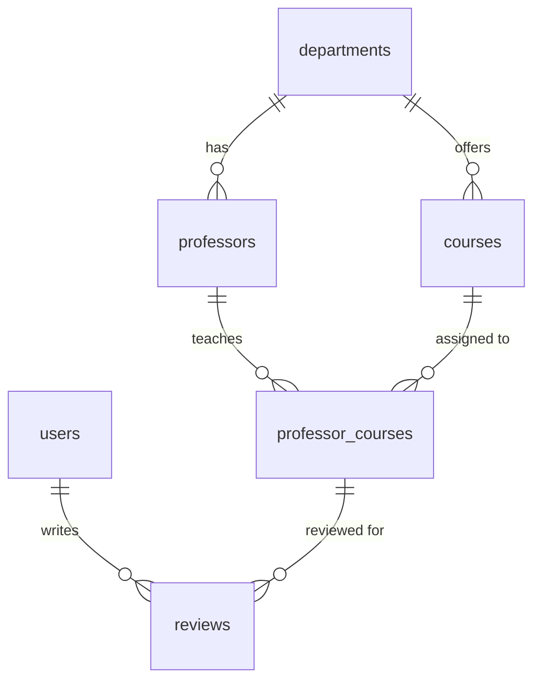

# CourseLens

A course rating site for students, built by the Niner Miners for ITSC 3155. Students
review a course they took with a specific professor (difficulty, workload, usefulness,
skills covered) so others can decide what to register for.

## Tech stack

- **Backend:** Node.js and TypeScript
- **Database:** PostgreSQL 17, run locally in Docker
- **Query builder / migrations:** [Kysely](https://kysely.dev)

## Project structure

```
.
├── docker-compose.yaml      PostgreSQL container for local development
├── PRD.txt                  product requirements document
└── server/
    ├── .env.example         copy to .env and fill in
    ├── package.json
    └── src/db/
        ├── database.ts      Kysely connection (reads DATABASE_URL)
        ├── types.ts         TypeScript types for every table
        ├── migrate.ts       runs migrations up to the latest
        ├── seed.ts          fills the database with sample data
        └── migrations/      one file per schema change
```

## Prerequisites

- [Node.js](https://nodejs.org) 20 or newer
- [Docker Desktop](https://www.docker.com/products/docker-desktop/) (or Docker Engine with Compose)
- Git

## Getting started

1. Clone the repo and move into it:

   ```bash
   git clone git@github.com:robertvalencia755-web/ITSC-3155-Final-Project.git
   cd ITSC-3155-Final-Project
   ```

2. Start the database. This runs PostgreSQL on port **5433** so it does not clash with a
   Postgres you may already have on 5432:

   ```bash
   docker compose up -d
   ```

3. Install the server dependencies:

   ```bash
   cd server
   npm install
   ```

4. Create your `.env` file from the example. The default values match `docker-compose.yaml`,
   so you do not need to change anything:

   ```bash
   cp .env.example .env
   ```

5. Create the tables, then load the sample data:

   ```bash
   npm run db:migrate
   npm run db:seed
   ```

   You should see `Seeded 3 departments, 9 courses, 7 professors, 4 users, 10 reviews.`

## npm scripts

Run these from the `server/` folder.

| Script | What it does |
|---|---|
| `npm run db:migrate` | Applies any migrations that have not run yet |
| `npm run db:seed` | Deletes all rows and reloads the sample data |

## Sample data

`npm run db:seed` **wipes every table** and inserts fresh sample data, so it is safe to run
again whenever your local data gets messy. It refuses to run when `NODE_ENV=production`.

All professors, users and reviews are made up. Every seeded account uses the password
`password123`:

| Username | Email |
|---|---|
| `maya_cs` | maya@example.com |
| `jordan_transfer` | jordan@example.com |
| `priya_reviews` | priya@example.com |
| `demo_user` | demo@example.com |

Seeded passwords are hashed with Node's built-in `crypto.scrypt` and stored as
`scrypt:<salt>:<hash>`. If sign-in ends up using a different hashing library, `hashPassword`
in `server/src/db/seed.ts` should be changed to match so these accounts can log in.

## Database schema



| Table | Holds |
|---|---|
| `departments` | Department names |
| `professors` | Professors and the department they belong to |
| `courses` | Course code and name, unique per department |
| `professor_courses` | Which professor teaches which course |
| `users` | Accounts (username, email, password hash) |
| `reviews` | One user's review of one course taught by one professor |

A review must point at a professor and course pair that exists in `professor_courses`.
`overall_rating`, `difficulty` and `usefulness` are whole numbers from 1 to 5.

### Adding a migration

Add a new file in `server/src/db/migrations/` with the next number (for example
`002_add_course_description.ts`) that exports `up` and `down` functions, update
`server/src/db/types.ts` to match, then run `npm run db:migrate`. Never edit a migration
that has already been merged.

## Resetting the database

To start over with an empty database:

```bash
docker compose down -v
docker compose up -d
cd server
npm run db:migrate
npm run db:seed
```

`down -v` deletes the database volume, so every row is gone.

## Team workflow

- Work on your own branch named `<initials>-Sprint-<n>` (for example `CE-Sprint-1`).
- Open a pull request into `main` and get a review before merging.
- Never commit `.env`; it is in `.gitignore`.

## Team

Niner Miners: Akira, Anastasiia, Cadence, Connor, Jarius, Robert.
