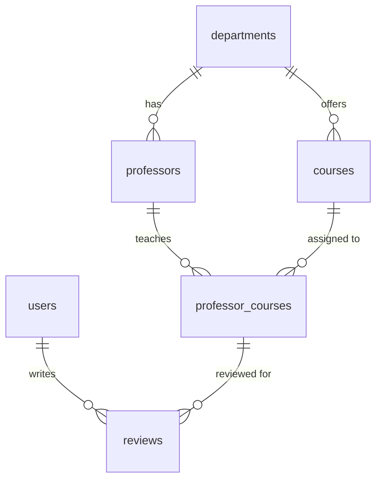

# CourseLens

A course rating site for students, built by the Niner Miners for ITSC 3155. Students
review a course they took with a specific professor (difficulty, workload, usefulness,
skills covered) so others can decide what to register for.

## Tech stack

- **Backend:** Node.js and TypeScript
- **Database:** PostgreSQL 17, run locally in Docker
- **Query builder / migrations:** [Kysely](https://kysely.dev)

## Project structure

```
.
├── docker-compose.yaml      PostgreSQL container for local development
├── Project-Documentation/   PRD and ERD
└── server/
    ├── .env.example         copy to .env and fill in
    ├── package.json
    └── src/
        ├── app.ts           Express app: middleware and route mounting
        ├── server.ts        starts the app on PORT (default 3000)
        ├── routes/          one file per resource under /api
        ├── Validation/      review validation shared by the API and the seed
        └── db/
            ├── database.ts  Kysely connection (reads DATABASE_URL)
            ├── types.ts     TypeScript types for every table
            ├── migrate.ts   runs migrations up to the latest
            ├── seed.ts      fills the database with sample data
            └── migrations/  one file per schema change
```

## Prerequisites

- [Node.js](https://nodejs.org) 20 or newer
- [Docker Desktop](https://www.docker.com/products/docker-desktop/) (or Docker Engine with Compose)
- Git

## Getting started

1. Clone the repo and move into it:

   ```bash
   git clone git@github.com:robertvalencia755-web/ITSC-3155-Final-Project.git
   cd ITSC-3155-Final-Project
   ```

2. Start the database. This runs PostgreSQL on port **5433** so it does not clash with a
   Postgres you may already have on 5432:

   ```bash
   docker compose up -d
   ```

3. Install the server dependencies:

   ```bash
   cd server
   npm install
   ```

4. Create your `.env` file from the example. The default values match `docker-compose.yaml`,
   so you do not need to change anything:

   ```bash
   cp .env.example .env
   ```

5. Create the tables, then load the sample data:

   ```bash
   npm run db:migrate
   npm run db:seed
   ```

   You should see `Seeded 3 departments, 9 courses, 7 professors, 4 users, 10 reviews.`

6. Start the API. It restarts whenever you save a file:

   ```bash
   npm run dev
   ```

   Open http://localhost:3000/api/courses to check it is serving data.

If `docker compose up -d` fails with `port is already allocated`, another Postgres is
already on 5433. Pick a free port, start the container on it, and point `.env` at it:

```bash
DB_PORT=5435 docker compose up -d
```

Then change `5433` to `5435` in `server/.env`.

## npm scripts

Run these from the `server/` folder.

| Script | What it does |
|---|---|
| `npm run dev` | Runs the API on port 3000 and restarts on file changes |
| `npm test` | Unit tests (no database needed) |
| `npm run test:db` | API tests against the local database; run `db:seed` first |
| `npm run typecheck` | Type-checks without building |
| `npm run db:migrate` | Applies any migrations that have not run yet |
| `npm run db:seed` | Deletes all rows and reloads the sample data |

## API

Every route returns JSON. Errors look like `{ "error": "Course not found" }` with a 400, 404
or 500 status. CORS is open, so a frontend dev server on another port can call the API directly.

| Method and path | Returns | Used by |
|---|---|---|
| `GET /health` | `{ "status": "ok" }` | checks |
| `GET /api/courses` | every course with department and review averages | Catalogue, Home |
| `GET /api/courses?q=okafor` | courses whose code, name, professor or a review skill matches | Catalogue search |
| `GET /api/courses?department_id=1&professor_id=2` | filters, combinable with `q` | Catalogue filters |
| `GET /api/courses/:id` | one course, its averages, and each professor who teaches it with their averages for it | Course page |
| `GET /api/courses/:id/reviews` | reviews, newest first, with `username` and `professor_name`; add `?professor_id=` for one section | Course page |
| `GET /api/professors` | every professor with averages; `?q=` and `?department_id=` filter | Catalogue |
| `GET /api/professors/:id` | one professor and the courses they teach | Course page links |
| `GET /api/professors/:id/reviews` | that professor's reviews across courses | |
| `GET /api/departments` | departments for filter dropdowns | Catalogue |
| `GET /api/users/:id` | `user_id`, `username`, `created_at`, `review_count` (never email or password) | Profile |
| `GET /api/users/:id/reviews` | the user's reviews with course and professor names | Profile |
| `POST /api/reviews` | creates a review, returns it with status 201 | review form |

Averages (`avg_rating`, `avg_difficulty`, `avg_usefulness`, `avg_time_commitment`) are rounded to
two decimals and are `null` when there are no reviews. `avg_grade_points` counts A as 4 down to
F as 0 and skips reviews with no grade.

A `POST /api/reviews` body looks like this. `grade`, `workload`, `skills`, `time_commitment` and
`review_text` may be left out or `null`:

```json
{
  "user_id": 4,
  "professor_id": 3,
  "course_id": 4,
  "overall_rating": 4,
  "difficulty": 3,
  "usefulness": 5,
  "grade": "A",
  "semester": "Fall 2026",
  "textbook_used": false,
  "workload": "Moderate",
  "skills": ["Git", "TypeScript"],
  "time_commitment": 5.5,
  "review_text": "Communicate with your team early."
}
```

There is no sign-in yet, so `user_id` is taken from the body. That changes once auth exists.

## Sample data

`npm run db:seed` **wipes every table** and inserts fresh sample data, so it is safe to run
again whenever your local data gets messy. It refuses to run when `NODE_ENV=production`.

All professors, users and reviews are made up. Every seeded account uses the password
`password123`:

| Username | Email |
|---|---|
| `maya_cs` | maya@example.com |
| `jordan_transfer` | jordan@example.com |
| `priya_reviews` | priya@example.com |
| `demo_user` | demo@example.com |

Seeded passwords are hashed with Node's built-in `crypto.scrypt` and stored as
`scrypt:<salt>:<hash>`. If sign-in ends up using a different hashing library, `hashPassword`
in `server/src/db/seed.ts` should be changed to match so these accounts can log in.

## Database schema



| Table | Holds |
|---|---|
| `departments` | Department names |
| `professors` | Professors and the department they belong to |
| `courses` | Course code and name, unique per department |
| `professor_courses` | Which professor teaches which course |
| `users` | Accounts (username, email, password hash) |
| `reviews` | One user's review of one course taught by one professor |

A review must point at a professor and course pair that exists in `professor_courses`.
`overall_rating`, `difficulty` and `usefulness` are whole numbers from 1 to 5. `grade` is one of
A, B, C, D, F or null, and `time_commitment` (hours per week) may be a decimal.

### Adding a migration

Add a new file in `server/src/db/migrations/` with the next number (for example
`002_add_course_description.ts`) that exports `up` and `down` functions, update
`server/src/db/types.ts` to match, then run `npm run db:migrate`. Never edit a migration
that has already been merged.

## Resetting the database

To start over with an empty database:

```bash
docker compose down -v
docker compose up -d
cd server
npm run db:migrate
npm run db:seed
```

`down -v` deletes the database volume, so every row is gone.

## Team workflow

- Work on your own branch named `<initials>-Sprint-<n>` (for example `CE-Sprint-1`).
- Open a pull request into `main` and get a review before merging.
- Never commit `.env`; it is in `.gitignore`.

## Team

Niner Miners: Akira, Anastasiia, Cadence, Connor, Jarius, Robert.
